# Krypt major project: implementation plan

Prepared 2026-10-16. This is the working hand-off: what to build, in what order, who owns it, and how you know a step is done.

- **Why** each piece exists, and the cryptography behind it: `Krypt_Major_Project_Strategy.md`
- **Engineering rules** (key hierarchy, nonce rules, storage rules): `Krypt_Cryptographic_Handoff.md`

## Start here (first 2 hours)

1. Agree the two roles in section 1 and write your names next to them.
2. Run `git tag protocol-v0` on the current `main` and push the tag. Every "before" measurement is taken against this tag.
3. Open step **0.1** below and do it. Each step has a "done when" line. Tick it in this file when it passes.

---

## 1. Roles

The work splits cleanly into two tracks that meet at the protocol interface (`SessionManager`).

| Role | Owns | Contributions |
|---|---|---|
| **P: Protocol owner** | Everything in `frontend/src/crypto/`, the wire format spec, the ProVerif model | C1 (ratchet), the hybrid option, C4 envelope crypto |
| **S: Systems owner** | Backend, Postgres, key transparency, test and benchmark harnesses, CI | C2 (key transparency), C3 (evaluation), C4 simulator |

Both of you review each other's pull requests. Every crypto PR needs a test that fails before the change.

Names: P = __________ S = __________

## 2. Timeline at a glance

The plan assumes **24 weeks** of part-time work (about 15 hours per person per week). If your semester is shorter, cut Phase 4 first, then shrink Phase 3. Never cut Phase 0.

| Phase | Weeks | Goal | Gate to pass before moving on |
|---|---|---|---|
| 0. Freeze and fix the foundation | 1-2 | v0 measured, auth real, no secrets in plain storage | Evil-relay harness cannot hijack a socket |
| 1. Protocol core + harnesses | 3-8 | KEM handshake, KEM ratchet, state machine; test, KAT and benchmark harnesses | All fault-injection tests green |
| 2. Formal model + transparency log | 9-13 | ProVerif model; KT log, proofs and witness live | ProVerif: secrecy + auth hold; witness cosigning |
| 3. Integration + measurement | 14-17 | KT in the client, hybrid mode, full experiment runs | All figures for the report exist as data |
| 4. Sealed sender + SDA study | 18-21 | Metadata contribution (or buffer if late) | SDA accuracy table, before vs after |
| 5. Write, demo, defend | 22-24 | Report, slides, recorded demos | Dry-run viva with a friend playing examiner |

```mermaid
gantt
  dateFormat  X
  axisFormat  W%s
  section P (protocol)
  Phase 0 fixes (client)     :0, 2
  Spec + crypto modules      :2, 5
  SessionManager + hooks     :5, 8
  ProVerif model             :8, 13
  Hybrid + KT client         :13, 17
  Sealed envelope            :17, 21
  Write-up                   :21, 24
  section S (systems)
  Phase 0 fixes (server)     :0, 2
  Test, KAT, bench, evil relay :2, 8
  KT log + witness           :8, 13
  Run experiments            :13, 17
  SDA simulator              :17, 21
  Write-up                   :21, 24
```



---

## Phase 0: freeze and fix the foundation (weeks 1-2)

**Goal:** measure v0 as it is, then close the holes an examiner would find in minutes. None of this is a contribution, but all of it is required.

| ID | Step | Files | Owner | Time |
|---|---|---|---|---|
| 0.1 | Tag `protocol-v0`. Add a protocol version field `v: 0` to the current payload so v1 can coexist | `useChat.ts`, `server.ts` | P | 1 h |
| 0.2 | Add Vitest to `frontend/` and `primary-backend/`, plus a GitHub Actions workflow running lint + tests on every PR | `package.json` ×2, `.github/workflows/ci.yml` | S | 3 h |
| 0.3 | **Evil relay v0 run.** Add an `EVIL_MODE` env flag to the server with 4 attacks: replay handshake, swap public key, drop one message, flip `type` to `image`. Record what v0 does in `eval/attack-matrix-v0.md` | `primary-backend/src/evil.ts` (new) | S | 1 day |
| 0.4 | Real login session: server checks SRP `M1`, returns `M2`; client verifies `M2` (`useAuth.ts:125-141`); server issues a short-lived signed token (HMAC-SHA-256, 1 h, refresh on use) | `api.ts:86-126`, `useAuth.ts` | S | 1 day |
| 0.5 | Authenticate every REST route from the token, never from body/params (fixes BOLA in `api.ts:188-560`) | `api.ts`, new `auth.ts` middleware | S | 1 day |
| 0.6 | Authenticate sockets: client sends the token in `io(url, { auth: { token } })`; server binds `socket.data.userId`; delete trust in `register_socket(anyName)` (`server.ts:38-48`) | `server.ts`, `services/socket.ts` | S | 4 h |
| 0.7 | Mailbox correctness: flush queue **before** marking online; delete by row ids, not `deleteMany({to})`; add TTL (7 days) and per-user quota; set Socket.io `maxHttpBufferSize` to match the client's audio limit | `server.ts:42-73` | S | 4 h |
| 0.8 | Validate every incoming socket payload with `zod` (sizes, types, required fields); reject before forwarding | `server.ts` | S | 4 h |
| 0.9 | Remove the CBC/WASM fallback from live decryption; anything not `GCM:` fails closed (`aes_wasm.ts:113-114`) | `aes_wasm.ts` | P | 1 h |
| 0.10 | Stop storing the plaintext password in `sessionStorage` (`useAuth.ts:218`). Replace with a **non-extractable** `CryptoKey` (PBKDF2-derived) stored in IndexedDB; Web Crypto can store a key object there that JavaScript cannot read out | `useAuth.ts`, `vault.ts` | P | 1 day |
| 0.11 | Make the vault password mandatory; refuse unencrypted export (`vault.ts:25-28`); force vault download at registration | `vault.ts`, `Sidebar.tsx`, `useAuth.ts` | P | 3 h |
| 0.12 | Prisma: switch `BlockedUser`/`FriendRequest` to `User.id` UUID foreign keys; generate real migrations for `BlockedUser` and `OfflineMessage` (today they exist only via `db push`) | `schema.prisma`, `prisma/migrations/` | S | 4 h |
| 0.13 | Rewrite README claims using the table in strategy section 7.3 | `README.md`, `flow.md` | P | 2 h |

**Done when:**

- [ ] `eval/attack-matrix-v0.md` records v0 results for the 4 attacks
- [ ] A second browser that claims another username gets rejected on socket connect and on every REST route
- [ ] No password, private key or chain key is readable in `localStorage`/`sessionStorage` (check in DevTools, screenshot for the report)
- [ ] CI is green on `main`

**Risk:** step 0.10 changes refresh behaviour. If it takes over a day, accept "re-enter password on refresh" and move on.

---

## Phase 1: protocol core + harnesses (weeks 3-8)

### Track P: the protocol (C1)

Write the spec **before** the code. The spec is a thesis chapter, and it stops the two of you from arguing about bytes later.

| ID | Step | Files | Time |
|---|---|---|---|
| 1.1 | Write `docs/protocol/krypt-v1.md`: key hierarchy, handshake, ratchet, byte-level wire format, error policy. Copy the math from strategy sections 4.3-4.4 | new | 3 days |
| 1.2 | Canonical encoding: length-prefixed fields, fixed domain-separation labels, Base64URL only at the network edge | `crypto/encoding.ts` | 1 day |
| 1.3 | KDF module: `hkdf()`, `kdfRoot()`, `kdfChain()`, `messageKeyAndIv()` on Web Crypto; unit tests with RFC 5869 vectors | `crypto/kdf.ts` | 1 day |
| 1.4 | Typed KEM/signature wrappers: ML-KEM-768/1024, X-Wing (`ml_kem768_x25519`), ML-DSA-87. Check exact lengths before every call; never log secrets. Rename `mlkem.ts` to `pq.ts` | `crypto/pq.ts` | 1 day |
| 1.5 | Prekey generation client-side: 1 signed prekey (weekly rotation) + 100 one-time prekeys, each ML-DSA signed; private halves stored encrypted in IndexedDB | `crypto/prekeys.ts` | 2 days |
| 1.6 | Handshake (Krypt-X3K): `initiate(bundle)` and `respond(initHeader)`, building transcript `T`, signing `H(T)`, `sessionId = H(T)`. Alice repeats the init header on every epoch-0 message until Bob replies; Bob treats a repeat with a known `sessionId` as the same session. Bob keeps an `H(T)` replay cache per SPK until that SPK is deleted | `crypto/handshake.ts` | 3 days |
| 1.7 | `SessionManager`: chain step, root step (alternating KEM ratchet), counters `n`/`pn`, skipped-key store (MAX_SKIP 1000, total 2000, 7-day TTL), **commit only after AES-GCM verifies**. Follow strategy section 4.4 exactly for the **epoch rule** (each root step uses the epoch of the chain it creates) and **Bob's send-only bootstrap** (`CKs = ⊥` until his first send) | `crypto/session.ts` | 1.5 weeks |
| 1.7b | No-rollback rules (nonce safety): persist the next chain key **before** the message leaves; wrap every encrypt/decrypt in `navigator.locks.request("krypt-session-" + id, …)` so two tabs never share a chain; exclude ratchet state from chat backups | `crypto/session.ts`, `vault.ts` | 1 day |
| 1.8 | Persist session state encrypted in IndexedDB (key from the vault key); delete all `session_*` entries from `localStorage` | `crypto/session-store.ts`, `services/db.ts` | 2 days |
| 1.9 | Wire it in: `useRatchet.ts` becomes a thin adapter; `useChat.ts` and `useSocketListeners.ts` call `SessionManager` only; envelope `v: 1` with header as AAD | hooks | 3 days |
| 1.10 | Media: random 32-byte file key per attachment, file encrypted with it, file key carried inside the message envelope | `useChat.ts` | 1 day |
| 1.11 | Sparse-mode switch `RATCHET_EVERY_K` (default 1) so experiment E7 can vary it | `crypto/session.ts` | 2 h |

Tests P must write alongside (Vitest, run in CI):

| Test group | Cases |
|---|---|
| Round trip | Alice↔Bob 1,000 alternating messages; 1,000 one-direction messages |
| Ordering | Reorder within window; gap of MAX_SKIP + 1 (must reject); duplicate (must reject); simultaneous sends from both sides |
| Tamper | Bit flip in header, ciphertext, tag, KEM ct, `ek`; wrong session id; wrong epoch: all rejected, **state unchanged** |
| Handshake | Replay an init header for a closed session (rejected); repeated init header for a live session (same session, no reset); swapped prekey signature (rejected); empty one-time pool falls back to signed prekey; SPK-only handshake replayed (rejected by the `H(T)` cache); lost first message (session still starts) |
| Epochs | Both sides derive identical `CKs`/`CKr` for epochs 0-5, checked by comparing key hashes in the test |
| Rollback | Two tabs sending at once never reuse a chain key; a crash between encrypt and persist never resends with the same key |
| Recovery | Snapshot Alice's state at message k. The attacker clone reads Alice's rest-of-epoch messages and Bob's next reply, then fails from Alice's first message after Bob's reply |

**Track P done when:** every test above passes in CI, and two browsers chat through the real relay with the evil relay's drop and reorder attacks switched on.

### Track S: harnesses and backend (C3 foundation)

| ID | Step | Files | Time |
|---|---|---|---|
| 1.20 | Prekey backend: tables `SignedPrekey`, `OneTimePrekey`; `POST /prekeys` (authenticated upload), `GET /bundle/:user` claims one OPK atomically with `DELETE … WHERE id = (SELECT id … FOR UPDATE SKIP LOCKED LIMIT 1) RETURNING *`; socket event asks client to refill below 20 | `schema.prisma`, `api.ts` | 3 days |
| 1.21 | KAT suite: download NIST ACVP JSON (`ML-KEM-*-FIPS203`, `ML-DSA-*-FIPS204`) and Wycheproof (`aes_gcm`, `hkdf_sha256`, `mlkem_*`, `mldsa_*`); run them through P's wrappers in `crypto/pq.ts` and `crypto/kdf.ts` | `frontend/test/kat/` | 3 days |
| 1.22 | Fuzz and property tests: `fast-check` over the envelope parser; `@jazzer.js/core` for a 1-hour fuzz run; pass = only typed `DecryptError`, no crash or hang | `frontend/test/fuzz/` | 2 days |
| 1.23 | Evil relay v1: extend `evil.ts` to the full attack list (replay, reorder, drop, duplicate, tamper header/ct/tag, key swap, prekey rollback, cross-session injection) with a CLI to pick an attack | `primary-backend/src/evil.ts` | 3 days |
| 1.24 | Benchmark page: separate Vite entry `bench.html`, served with `Cross-Origin-Opener-Policy: same-origin` and `Cross-Origin-Embedder-Policy: require-corp`; `tinybench` in a Web Worker; writes JSON to `window.__results` and records `crossOriginIsolated` | `frontend/bench/` | 3 days |
| 1.25 | Playwright runner: launches Chromium, Firefox, WebKit, runs `bench.html` 5 times each, saves `eval/results/*.json` | `eval/run-bench.ts` | 2 days |
| 1.26 | Plot scripts (Python + matplotlib, or Observable): read results JSON, output the figures listed in strategy section 6.1 | `eval/plots/` | 2 days |

**Track S done when:** `npm run bench` produces a results file for 3 browsers; `npm run test:kat` passes; the evil relay can run each attack by name.

---

## Phase 2: formal model + transparency log (weeks 9-13)

### Track P: ProVerif model (C1 evidence)

| ID | Step | Time |
|---|---|---|
| 2.1 | Install ProVerif (`opam install proverif`); run the published PQXDH models from `Inria-Prosecco/pqxdh-analysis` (`revision2/`) to learn the syntax | 2 days |
| 2.2 | Model the handshake: KEM equational theory, ML-DSA as a signature theory, transcript `T`. Queries: secrecy of the first message key; `inj-event(BobAccepts) ==> inj-event(AliceInit)` | 1 week |
| 2.3 | Add 2-3 ratchet epochs (unrolled). Forward-secrecy query: leak long-term keys in `phase 1`. PCS query: leak Alice's state in phase 1, honest steps in phase 2, secrecy of a phase-2 message | 1 week |
| 2.4 | **Weak variant:** swap in a deliberately non-binding KEM theory (see the Bhargavan et al. models), remove `H(ek)` from the root KDF context, and give the attacker one compromised ratchet `dk`. **Fixed variant:** add `H(ek)` back. Save both outputs. The plain KEM theory from 2.2 is binding by construction and will never show this attack | 3 days |
| 2.5 | Write `docs/protocol/proverif.md`: what is modelled, what is abstracted away (symbolic model, bounded epochs), results table | 1 day |

**Done when:** `make proverif` runs all queries, and the weak-vs-fixed results table exists. If 2.3 stalls past week 12, ship the handshake model alone and list the ratchet model as future work.

### Track S: key transparency (C2)

| ID | Step | Files | Time |
|---|---|---|---|
| 2.20 | Shared Merkle module (RFC 9162): leaf/node hashing with `0x00`/`0x01` prefixes, root, inclusion proof, consistency proof, both verifiers. Test against `transparency-dev/merkle` vectors | `shared/merkle.ts` | 1 week |
| 2.21 | Tables `kt_leaves`, `kt_nodes`, `kt_sth`; append a leaf on register/rotate/revoke; leaf encoding from strategy section 5.2; a rotation leaf must carry a signature by the previous key | `schema.prisma`, `kt.ts` | 3 days |
| 2.22 | Publish signed tree heads lazily (on write or on read when leaves are pending, at most every 5 minutes) because Render free tier sleeps. Sign with a server ML-DSA key; ship its public key in the frontend build | `kt.ts` | 2 days |
| 2.23 | Endpoints: `GET /kt/sth`, `GET /kt/proof?user=`, `GET /kt/consistency?from=&to=`, `GET /kt/leaves?from=&to=` | `api.ts` | 2 days |
| 2.24 | Witness: GitHub Action on a 15-minute schedule fetches the head, verifies consistency with its last cosigned head, refuses inconsistent heads, cosigns with its own ML-DSA key (secret in GitHub Secrets), commits `witness/latest.json` to GitHub Pages | separate repo `krypt-witness` | 3 days |
| 2.25 | Evil relay KT attacks: inject a rogue key leaf; serve a forked head to one client; rewrite history | `evil.ts` | 2 days |

**Done when:** the witness has cosigned heads for 3 days in a row, and the history-rewrite attack fails consistency verification in a test.

Note: GitHub disables scheduled workflows in public repos after 60 days with no activity. Push a commit to the witness repo at least monthly.

---

## Phase 3: integration + measurement (weeks 14-17)

### Track P

| ID | Step | Time |
|---|---|---|
| 3.1 | Client KT lookup: before any handshake, verify the peer's identity key with an inclusion proof, the head signature, and consistency with the witness head and the last head seen | 3 days |
| 3.2 | Owner self-monitoring on login: download all new leaves, alert if any leaf for my username is not mine | 2 days |
| 3.3 | Gossip: put `(tree_size, root)` inside encrypted payloads; compare with the receiver's view; alert on fork | 1 day |
| 3.4 | Security UI: identity-key-change warning, safety-number / QR screen (`SHA-256` of both identity keys, sorted), a session status panel showing epoch and last ratchet | 3 days |
| 3.5 | Hybrid mode: flag `KEM_SUITE = "mlkem768" | "xwing"`; same `SessionManager`; tests run for both suites | 2 days |

### Track S: run the experiments

| ID | Experiment (strategy section 6.1) | Output |
|---|---|---|
| 3.20 | E1-E3: PQ and classical primitives × noble / liboqs-js / native WebCrypto × Chrome / Firefox / WebKit / real Safari / Android phone | `eval/results/primitives/*.json` |
| 3.21 | E5: bytes per handshake and per message, raw vs Base64 vs binary frames | table |
| 3.22 | E6: end-to-end latency, 500 messages warm and 20 cold starts on Render | CDF data |
| 3.23 | E7: sparse ratchet K = 1, 10, 50, 100: bytes/message (about 2.3 KB at K = 1, since every header repeats `ct` + `ek`), CPU/message, messages-to-heal | the key C1 figure |
| 3.24 | E10: Node 24.7+ native ML-KEM vs noble in Node | bar data |
| 3.25 | Attack matrix v1: run every evil-relay attack against v1; write `eval/attack-matrix-v1.md` next to the v0 file | table |

Rules for every run: record browser version, device, `crossOriginIsolated`, power state. Report median, p95 and bootstrap 95% CI. Never average warm and cold latency together.

**Done when:** every figure in strategy section 6.1 can be drawn from saved data, and the v0 vs v1 attack matrix is complete.

---

## Phase 4: sealed sender + SDA study (weeks 18-21)

Skip this phase if Phases 1-3 slipped by more than 2 weeks. Use the time as buffer instead and list C4 as future work.

| ID | Step | Owner | Time |
|---|---|---|---|
| 4.1 | Sealed envelope: KEM to recipient, sender fingerprint + inner ciphertext + signature inside, padded to 4 size buckets (2, 8, 32, 128 KB) | P | 1 week |
| 4.2 | Delivery token `dt = HKDF(profileKey, "Krypt-DT")`; unauthenticated send socket accepting `{mailbox, token, C}`; server stores no sender field | S | 4 days |
| 4.3 | Receipt jitter (uniform 0-30 s) and optional receipts-off setting | P | 1 day |
| 4.4 | SDA simulator: 1,000-10,000 users, power-law contact graph, Poisson background traffic, emits Krypt's exact server log format | S | 1 week |
| 4.5 | Attacker + results: top-1/top-5 accuracy vs messages observed, for (i) v1 plain, (ii) sealed, (iii) + jitter, (iv) + padding and cover traffic | S | 3 days |

**Done when:** a grep of the server logs and schema shows no sender for sealed sends, and the SDA accuracy table exists.

---

## Phase 5: write, demo, defend (weeks 22-24)

| ID | Step | Owner | Time |
|---|---|---|---|
| 5.1 | Report chapters: intro and threat model; background; C1 protocol + ProVerif; C2 KT; implementation; evaluation (C3); C4; limitations; future work | both | 2 weeks |
| 5.2 | Demo 1, "evil server": toggle the key-swap attack; v0 accepts it, v1 alerts. Record a video backup | S | 1 day |
| 5.3 | Demo 2, "compromise and heal": attacker console holding Alice's dumped state decrypts, then goes dark at Alice's first message after Bob's reply. Record a video backup | P | 1 day |
| 5.4 | Slides in the order of strategy section 7.1; at most 3 evaluation figures on slides, the rest in the report | both | 2 days |
| 5.5 | Mock viva: one person reads questions from strategy section 7.2 cold, the other answers without notes; swap | both | 2 h × 2 |

Before the viva, pre-warm Render (open the site 2 minutes before), or the first demo waits about 60 seconds on a cold start.

---

## Stretch: post-quantum WebRTC calls

Start only if Phase 3 finishes early. Expect 5-7 person-weeks. Order:

1. 1:1 audio call with signalling over the existing socket, ML-DSA-signed SDP including both DTLS fingerprints.
2. TURN credentials from Cloudflare Realtime (free 1,000 GB/month).
3. `RTCRtpScriptTransform` worker encrypting Opus frames with SFrame (RFC 9605), keys from `HKDF(ratchetRoot, "krypt-sframe" ‖ epoch)`.
4. Video on Chrome ↔ Firefox. Safari is best effort.

---

## 3. Target code layout

```text
frontend/src/crypto/
  encoding.ts        canonical length-prefixed encoding         (new, 1.2)
  kdf.ts             HKDF / HMAC / message key + IV             (new, 1.3)
  pq.ts              ML-KEM-768/1024, X-Wing, ML-DSA-87 wrappers (was mlkem.ts, 1.4)
  prekeys.ts         prekey generation and storage              (new, 1.5)
  handshake.ts       Krypt-X3K                                  (new, 1.6)
  session.ts         SessionManager state machine               (new, 1.7)
  session-store.ts   encrypted IndexedDB persistence            (new, 1.8)
  kt.ts              transparency verification + monitoring     (new, 3.1)
  aes_wasm.ts        Web Crypto GCM only; CBC path removed      (0.9)
shared/merkle.ts     RFC 9162 tree + proofs, used by both sides (new, 2.20)
primary-backend/src/
  auth.ts            token issue + verify middleware            (new, 0.4-0.6)
  kt.ts              log append, STH publishing                 (new, 2.21-2.23)
  evil.ts            malicious relay modes                      (new, 0.3, 1.23)
docs/protocol/       krypt-v1.md, proverif.md, *.pv models
eval/                bench runner, results/, plots/, attack matrices
```

## 4. Decisions

Already decided (do not reopen without a reason):

| Decision | Choice |
|---|---|
| Offline delivery | Path A: ciphertext mailbox in Postgres, deleted on delivery (TEAM_DISCUSSION.md section 2) |
| Ratchet KEM | ML-KEM-768, X-Wing as a switchable hybrid |
| Prekey KEM | ML-KEM-1024 |
| Identity signatures | ML-DSA-87 |
| Formal tool | ProVerif |

Open, decide in week 1:

1. Semester length: is 24 weeks right? If not, apply the cut order from section 2.
2. Who is P and who is S.
3. Is C4 (sealed sender) in scope, or future work from day one?
4. Is the C AES code kept as a benchmark baseline (E4) or deleted?

## 5. Progress log

Update one line per week. Keep it short.

| Week | Done | Next | Blocked on |
|---|---|---|---|
| 1 | | 0.1-0.3 | |
