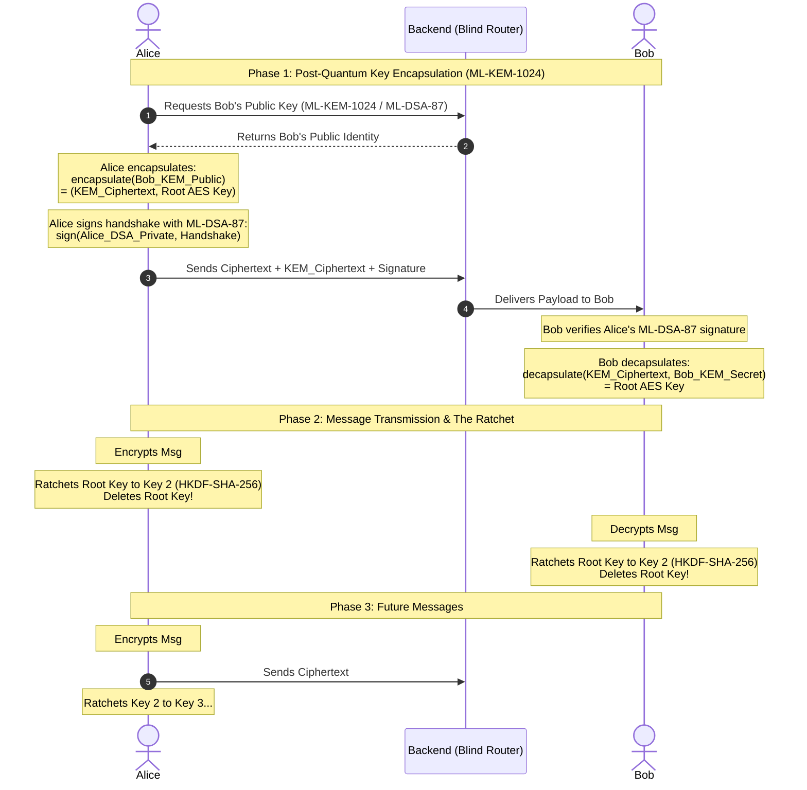
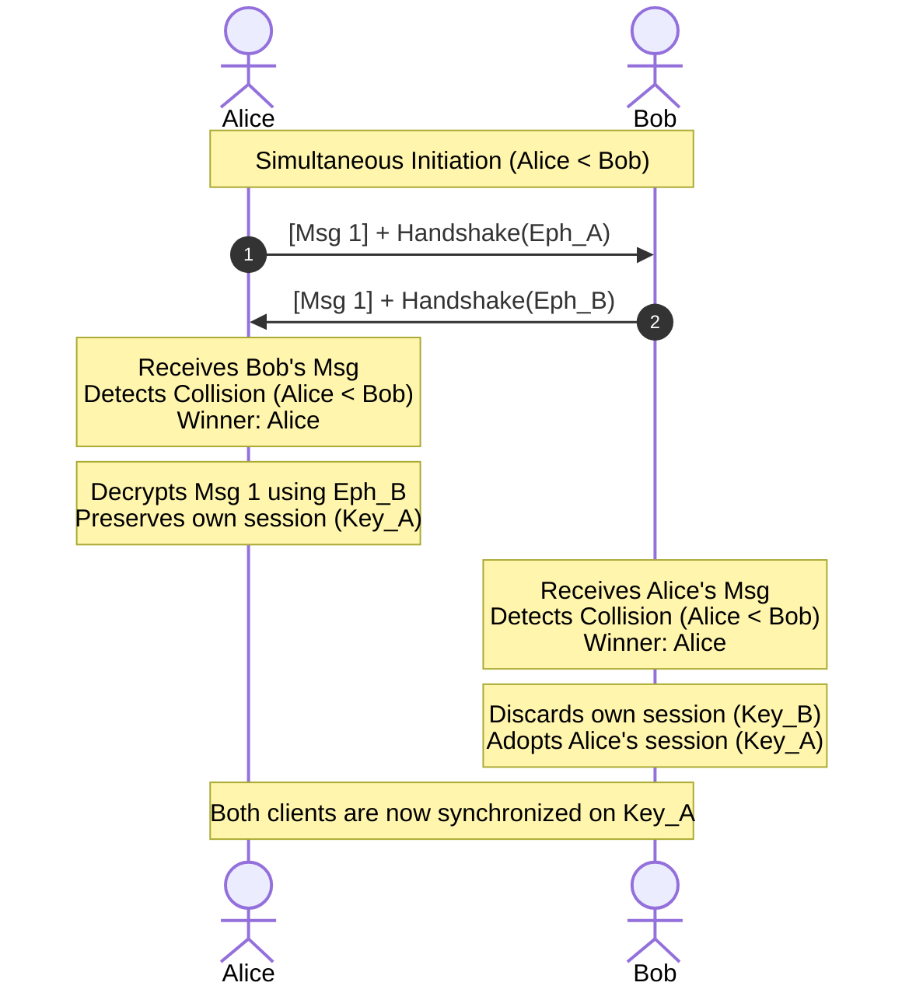

# 🛡️ Project Krypt: Post-Quantum E2EE Chat

**Project Krypt** is an End-to-End Encrypted (E2EE) real-time messaging application with post-quantum key establishment. The design goal is: no plaintext or keys server-side; ciphertext deleted on delivery; best-effort client wipe. The server stores an SRP verifier, never your password, and never sees your private keys.

It features **augmented PAKE login (SRP-6a)**, **Physical Vault Identities**, **Post-Quantum Key Encapsulation (ML-KEM-1024)** with **ML-DSA-87** signatures, a **symmetric hash ratchet (v0)**, and **AES-256-GCM** symmetric encryption via the browser's native Web Crypto API.

> **Status:** this README describes protocol **v0**. v0 does not provide forward secrecy against compromise of a long-term identity key, and its handshake is not yet replay-protected. These are being addressed in v1; see the [Roadmap (v1)](#-roadmap-v1).

## 🗺️ System Architecture

### 1. High-Level Infrastructure
The following diagram outlines the complete flow of data between the Vercel-hosted React clients, the Render-hosted Express WebSocket router, and the Neon Serverless PostgreSQL database.

```mermaid
flowchart TB
    subgraph Client_Alice [Alice's Client - Vercel]
        UI_A[React UI]
        AES_A[Web Crypto AES-256-GCM]
        MLKEM_A[Post-Quantum Engine (ML-KEM-1024 / ML-DSA-87)]
        DB_A[(IndexedDB / Secure Cache)]
    end

    subgraph Backend [Blind Router - Render.com]
        API[Express REST API]
        WS[Socket.io RAM Router]
    end

    subgraph Database [Database - Neon.tech]
        PG[(PostgreSQL)]
        USERS[Users & Friend Requests]
    end

    subgraph Client_Bob [Bob's Client - Vercel]
        UI_B[React UI]
    end

    %% Frontend Internal Logic
    UI_A <-->|1. Import Vault / Gen Keys| MLKEM_A
    UI_A <-->|2. Encrypt/Decrypt| AES_A
    UI_A <-->|3. Persist (locally encrypted)| DB_A

    %% Network Logic
    UI_A <-->|SRP Auth, Bearer Token & Invites| API
    UI_A <-->|Encrypted Ciphertext & Media Base64| WS
    UI_B <-->|Encrypted Ciphertext & Media Base64| WS
    
    %% Backend Logic
    API <-->|Validate & Query| USERS

    classDef client fill:#e6f2ff,stroke:#0066cc,stroke-width:2px;
    classDef backend fill:#f9f2ec,stroke:#cc6600,stroke-width:2px;
    classDef db fill:#e6ffe6,stroke:#009933,stroke-width:2px;
    
    class Client_Alice,Client_Bob client;
    class Backend backend;
    class Database db;
```

### 2. The ML-KEM-1024 & Ratchet Flow (v0)
This sequence diagram illustrates how Alice and Bob establish a shared AES key using ML-KEM-1024 key encapsulation (the FIPS 203 algorithm) with ML-DSA-87 (FIPS 204) signatures, and how the v0 symmetric hash ratchet (HKDF-SHA-256) advances the key after every message.



---

## 🛠️ Tech Stack

### Frontend (The Client Vault)
- **Framework:** React + Vite + TypeScript
- **State & Logic:** Custom React Hooks
- **Cryptography:** Native Web Crypto API (`window.crypto.subtle`) for AES-256-GCM, HKDF and PBKDF2; `@noble/post-quantum` for ML-KEM-1024 / ML-DSA-87; `secure-remote-password` (SRP-6a).
- **Session Management:** Password-encrypted physical `.vault` files, a short-lived bearer token (`sessionStorage`), and a refresh cache encrypted under a non-extractable Web Crypto key kept in IndexedDB.
- **Local Database:** `dexie` (IndexedDB) for persistent, client-side message storage.
- **Styling:** Tailwind CSS.
- **Hosting:** Vercel

### Backend (The Blind Router)
- **Framework:** Node.js + Express + TypeScript
- **Real-time & Media Routing:** Socket.io (Pure Memory Routing for text and large Base64 media).
- **Database ORM:** Prisma
- **Database:** PostgreSQL (Hosted on Neon.tech via Connection Pooling)
- **Security:** `helmet`, strict CORS.
- **Hosting:** Render.com

---

## 📂 Project Directory Structure
The application is organized into a frontend React application and a backend Node.js router:

### Frontend (`frontend/src/`)
```plaintext
src/
├── components/               # UI
│   ├── LoginForm.tsx         # SRP-6a login and vault upload
│   ├── Sidebar.tsx           # Friends, requests, search
│   ├── ChatWindow.tsx        # Message rendering and composer
│   ├── SecurityPanel.tsx     # Safety number, session and KT status per contact
│   ├── IdentityChangeDialog.tsx # Blocks sending until the user decides on a changed key
│   ├── KtBadge.tsx, ktSummary.ts # Key transparency status badge
│   ├── ImagePreview.tsx      # Image lightbox
│   └── VaultBackupModal.tsx  # Forced encrypted vault download after registration
├── hooks/
│   ├── useAuth.ts            # SRP-6a login (incl. server proof), token and session restore
│   ├── useProtocol.ts        # Starts the v1 protocol service after login
│   ├── useChat.ts            # Message list and sending
│   ├── useSocial.ts          # Friend management
│   └── useSocketListeners.ts # Incoming socket events
├── crypto/                   # Krypt v1 (spec: docs/protocol/krypt-v1.md)
│   ├── pq.ts                 # ML-KEM-1024 and ML-DSA-87 wrappers with input checks
│   ├── kdf.ts                # HKDF / HMAC key schedule, AES-256-GCM
│   ├── encoding.ts           # Length-prefixed canonical encoding
│   ├── prekeys.ts            # Signed and one-time prekeys, bundle verification
│   ├── handshake.ts          # Krypt-X3K handshake
│   ├── envelope.ts           # v1 envelope: header bytes, AAD, strict parsing
│   ├── session.ts            # SessionManager: the KEM ratchet state machine
│   ├── session-store.ts      # Encrypted IndexedDB session store
│   ├── appMessage.ts, media.ts # App message codec, attachment encryption
│   ├── safetyNumber.ts       # 60-digit safety numbers
│   ├── errors.ts             # Decrypt and handshake error codes
│   ├── mlkem.ts              # Long-term identity keys and their storage formats
│   ├── localStore.ts         # Encryption of the local message cache
│   └── vault.ts              # PBKDF2 + AES-GCM vault / backup encryption
├── services/
│   ├── protocol.ts           # Wires SessionManager, stores, prekeys and KT together
│   ├── messaging.ts          # Encrypt, relay, decrypt, re-send outbox
│   ├── messageState.ts       # Persisted outbox and seen message ids
│   ├── prekeyMaintenance.ts  # Keeps prekeys topped up and withdraws stale ones
│   ├── trust.ts, identityPrompt.ts # KT + trust-on-first-use pins, key-change prompt
│   ├── kt.ts                 # Key transparency client and monitoring
│   ├── api.ts, authToken.ts  # REST helper with bearer token; token storage
│   ├── socket.ts             # Socket.io client, token-authenticated connect
│   ├── sessionCache.ts       # Refresh cache under a non-extractable key
│   └── db.ts                 # Dexie (IndexedDB) configuration
└── App.tsx, main.tsx         # Layout and entry point
```

### Backend (`primary-backend/src/`)
```plaintext
src/
├── server.ts                 # HTTP + Socket.io server, startup
├── app.ts                    # Express app, middleware, error handler
├── auth.ts                   # HMAC bearer tokens for REST and sockets
├── api.ts, social.ts         # SRP auth, search, friends and blocks
├── sockets.ts, realtime.ts   # Message relay and presence
├── mailbox.ts                # Offline mailbox: TTL, row and byte quotas
├── prekeys.ts                # Prekey upload, bundle fetch, OPK claims
├── kt.ts, ktRoutes.ts        # Key transparency log and /kt endpoints
├── schemas.ts, sizes.ts      # Request validation, key and signature sizes
├── rateLimit.ts              # Rate limits
├── evil.ts                   # EVIL_MODE malicious relay, for attack tests only
├── db.ts                     # Prisma client
└── vendor/krypt-shared/      # Generated copy of shared/src (KT library)
```

---

## 🧮 Cryptographic Evolution & Theorems
This application was built in iterative phases, moving from legacy primitives to standardised ones. Formal analysis (a ProVerif model) is planned for v1 and is not yet done.

### 1. Augmented PAKE Login (Secure Remote Password - SRP-6a)
- **The Problem:** Sending a password to a server leaves it vulnerable to database leaks or MITM attacks.
- **The Idea:** SRP-6a is an augmented PAKE: the server stores a verifier, never the password, and the password never leaves the client.
- **Implementation:** The server stores a Salt and a Verifier. At login, client and server exchange ephemeral values; the client sends proof `M1`, and the server answers with proof `M2`, which the client verifies before accepting the session (mutual authentication). The server then issues a short-lived bearer token that authenticates every REST call and the WebSocket connection.

### 2. Identity Genesis & The Physical Vault
- **The Protocol:** During registration, the client generates a permanent ML-KEM-1024 (FIPS 203) KeyPair and ML-DSA-87 (FIPS 204) KeyPair. The public key bundle serves as the global "Identity Certificate."
- **Physical Custody:** The Private Key bundle is exported as a `.vault` file to the user's hard drive, always encrypted (PBKDF2-HMAC-SHA-256, 600,000 iterations → AES-256-GCM) under a mandatory vault password of at least 8 characters. Right after registration the app blocks the dashboard until this file has been downloaded. The server never sees the Private Keys.

### 3. Auto-Restoration (Tab Refreshing)
- **The Problem:** If a user refreshes the page, RAM is cleared. Forcing them to re-upload their `.vault` file on every refresh is poor UX.
- **Implementation:** No password is stored. After login the client generates a random, **non-extractable** AES-256-GCM `CryptoKey` and stores the key object in IndexedDB (script can use it but cannot read its bytes). The private key bundle is encrypted under it into `localStorage`, and a per-tab `sessionStorage` flag marks the session as live. A refresh in the same tab decrypts the bundle; a new tab or browser restart finds no flag, deletes the key and cache, and asks for the password again.

### 4. Post-Quantum Key Encapsulation (ML-KEM-1024 & ML-DSA-87)
- **The Idea:** Krypt implements the FIPS 203 (ML-KEM) and FIPS 204 (ML-DSA) algorithms via `@noble/post-quantum` (not a CMVP-validated module). ML-KEM is a module-lattice KEM designed to be IND-CCA2 secure, with no known efficient quantum attack (Shor's algorithm does not apply).
- **Implementation:** When initiating a session, Alice encapsulates a 32-byte shared secret using Bob's ML-KEM-1024 Public Key: `encapsulate(Public_Bob)`. This produces a 1568-byte ciphertext and a 32-byte Root AES Key. Alice signs the handshake payload with her ML-DSA-87 Private Key to guarantee authentic origin. Bob verifies the signature using Alice's pinned identity key and decapsulates: `decapsulate(Ciphertext, Private_Bob)`. Both parties independently arrive at the same Root AES Key (ML-KEM-1024 targets NIST security category 5).

### 5. Symmetric Hash Ratchet (v0)
- **The Problem:** Using the same AES key forever means a later key compromise exposes every message encrypted under it.
- **Implementation:** After sending/receiving a message, the app derives the next key from the current one with HKDF-SHA-256 and deletes the old key.
- **Limits (v0):** One chain is shared by both directions, and the root key is encapsulated to the peer's static identity key. Leaking that identity key exposes recorded traffic, so v0 does **not** claim perfect forward secrecy. v1 replaces this with a KEM-based double ratchet.

### 6. Handshake Collision Resolution (Deterministic Tie-Breaking)
- **The Problem:** In a truly decentralized E2EE system, if two users send their first message at the exact same millisecond, they both try to be the "Initiator" with different ephemeral keys. This leads to a state mismatch.
- **The Theorem:** Use a deterministic tie-breaker that requires zero network communication. 
- **Implementation:** Both clients compare usernames alphabetically. The lexicographically smaller username (e.g., "Alice" < "Bob") is designated the "Winner." The winner's ephemeral key becomes the root of the session. The loser detects the collision, discards their own initiation attempt, and adopts the winner's key.



### 7. Memory Routing & Symmetric Encryption
- **The Problem:** Asymmetric public-key operations are designed for key establishment and small payloads, not large media files, and saving temporary files to a server disk leaves a forensic trail.
- **Implementation:** The browser's native Web Crypto AES-256-GCM encrypts media on the client. Ciphertext that does not carry the `GCM:` format is rejected (fail closed). The encrypted blobs (Image/Audio) are sent as Base64 strings over the WebSocket. The backend acts as a "Blind Router": it forwards ciphertext to online recipients from RAM, queues it in an offline mailbox only while the recipient is offline, and deletes it on delivery. No plaintext or keys are held server-side.
- **Note:** An earlier C/WASM AES-CBC engine (`c_source/`) was removed in v1; it is in the `protocol-v0` tag for reference.

---

## 🚀 Development Roadmap & Architectural Phases
This project was intentionally built in distinct phases to validate each layer of the security architecture.

- **Phase 1: Password-less Server Storage:** Implemented SRP-6a (augmented PAKE). The database only stores `srpSalt` and `srpVerifier`.
- **Phase 2: The Blind Router:** Built the Express WebSocket router to handle real-time delivery without reading payloads.
- **Phase 3: Asymmetric Prototype (RSA):** Successfully implemented standard RSA-2048 E2EE. (Later deprecated).
- **Phase 4: Client-Side Persistence:** Migrated decrypted message storage exclusively to the client's local IndexedDB using `dexie`.
- **Phase 5: Rich Media via RAM Routing:** Added client-side AES encryption of images/audio (first via a C/WASM prototype, since replaced by Web Crypto AES-256-GCM), transmitting payloads directly over WebSockets to avoid backend file writes.
- **Phase 6: The Social Wall:** Built a robust Friend Request database schema (with instant Socket revocation via `request_revoked`) to prevent unauthorized payload spam.
- **Phase 7: Post-Quantum Cryptographic Upgrade (ML-KEM-1024):** Completely stripped out legacy ECDH. Upgraded the key sharing mechanism to ML-KEM-1024 (FIPS 203 algorithm) paired with ML-DSA-87 (FIPS 204 algorithm) signatures and the v0 symmetric hash ratchet.
- **Phase 8: Nuclear Logout & Identity Vaults:** Added encrypted `.vault` file exports, tab-scoped auto-restoration, and the "Nuclear Logout" mechanism that makes a best-effort wipe of IndexedDB and Local/Session storage.
- **Phase 9: Cloud Deployment:** Hardened Express with `helmet` and strict CORS. Deployed the PostgreSQL database to Neon, the API to Render, and the React client to Vercel.

---

## 🧭 Roadmap (v1)
The major-project work replaces the v0 protocol and closes the gaps found in the v0 audit. The full plan, with steps, owners and done-criteria, is in [`Krypt_Implementation_Plan.md`](Krypt_Implementation_Plan.md). In short:

- **Phase 0 (foundation):** token-authenticated REST and sockets, SRP server-proof check, no plaintext secrets in browser storage, fail-closed decryption, mandatory encrypted vaults.
- **v1 protocol:** a KEM-based double ratchet with a PQXDH-style handshake (prekeys, replay protection, bound transcript), modelled in ProVerif (symbolic model).
- **Post-quantum key transparency** and a **malicious-relay test harness** to measure v0 against v1.

---

## 💻 How to Run Locally

### 1. Clone the Repository
```bash
git clone https://github.com/yourusername/project-cipher.git
```

### 2. Setup the Database (Backend)
- Create a local PostgreSQL database (or use Neon.tech).
- Create a `.env` file in the `primary-backend` folder and add:
```env
DATABASE_URL="your_postgresql_connection_string"
DIRECT_URL="your_direct_connection_string"
```
- Run Prisma migrations:
```bash
cd primary-backend
npm install
npx prisma db push
```

### 3. Start the Backend
```bash
npm run dev
```

### 4. Start the Frontend
- Open a new terminal.
```bash
cd frontend
npm install
npm run dev
```

The app will be running at `http://localhost:5173`.

---

*Developed as an Advanced Security & Cryptography Capstone Project.*

## 📜 License
This project is licensed under the MIT License - see the [LICENSE](LICENSE) file for details.

---

### 🎓 Acknowledgments
**Minor project under the supervision of Dr. Sonal Chandel Ma'am**  
*Department of Computer Science & Engineering*

**Developed by:**
- **Anchal Jain** (Scholar Number: 23U02144)
- **Abhinav Singh Senger** (Scholar Number: 23U02142)